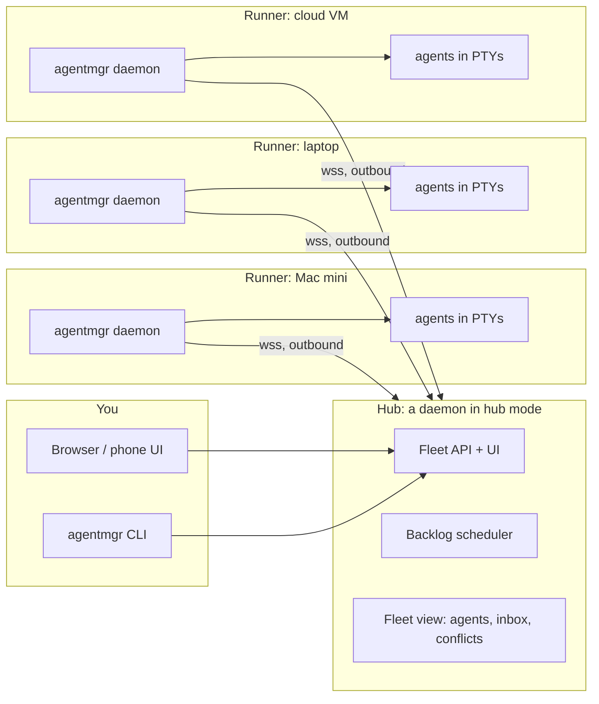

# Distributed agent management: design

Status: phases 1–3 built (0.3, branch `v0.3-fleet`) · Phases 4–5: planned

## Problem

Agent Manager runs every agent on the machine its daemon runs on. Once you have agents on more than one machine (a Mac mini that is always on, a laptop, a cloud VM with more cores, a teammate's box), you get one UI per machine, one inbox per machine, and a backlog that can't use spare capacity elsewhere. Overlaps between agents on different machines go unnoticed until merge time.

## Goals

- **One place to see and run everything:** all machines' agents, inbox and backlog in one UI and one CLI.
- **Use capacity wherever it is:** backlog items go to the machine with room, the repo already cached, and the right labels (OS, GPU, network access).
- **Keep machines independent:** a machine that loses the hub keeps running its agents and its local UI. No agent state is ever held only by the hub.
- **Nothing new to open on home networks:** machines connect out; no port forwarding.
- **At least as safe as today:** a live terminal is remote code execution, so every machine decides what the hub may do there.

## Non-goals (for now)

- Moving a running agent between machines. A fork across machines is in scope for a later phase; a live migration isn't.
- Several people sharing one hub. The design leaves room for it, but 0.3 is single-user.
- A multi-user hosted service. The hub will move to Railway, but as a single-user hub with one access token.

## Options considered

| | A. Federation | B. Hub and runners (recommended) | C. Hosted control plane |
| --- | --- | --- | --- |
| Shape | Each UI connects to every daemon directly | Daemons connect out to one hub; the UI talks to the hub | Daemons connect to a service on the internet (e.g. Railway) |
| Reachability | Every machine must be reachable from every client | Only the hub must be reachable, and only by the runners and you | Works anywhere |
| Shared backlog and scheduling | Hard: no one place decides | Natural: the hub schedules | Natural |
| Cross-machine inbox and conflicts | Merged in the browser | Computed at the hub | Computed centrally |
| Blast radius if compromised | One machine | The hub can reach every runner, limited by each runner's policy | An internet-facing service can reach every runner |
| Effort | Low | Medium | High (accounts, SSO, hardening, hosting) |

A is a fine stopgap but can't schedule. C is where a team product ends up, but it puts terminals behind an internet service before the trust model is proven. **B** gives one UI and real scheduling, works through NAT, and can later move the hub onto the internet without changing the runners.

## Architecture



- **Runner:** today's daemon plus a small hub client. It stays the source of truth for its agents: `state.json`, sessions, worktrees and checkpoints stay where they are, and its local UI keeps working.
- **Hub:** a daemon started with `agentmgr hub`. It can also run agents itself, as its own runner. It holds a cache of what runners report, plus fleet-wide things: the shared backlog and its assignments, enrolled runners, and the conflict view across machines.
- **One connection per runner:** a single WebSocket from runner to hub carries everything, multiplexed.

### What flows over the connection

| Frame | Direction | Purpose |
| --- | --- | --- |
| `challenge` | hub → runner | A fresh nonce the runner signs |
| `hello` | runner → hub | Runner ID, signature, version, platform, policy, UI addresses (later: labels, capacity, cached repos) |
| `welcome` | hub → runner | Accepted; the runner sends its state |
| `state` | runner → hub | The whole fleet view: whitelisted agent fields and inbox items (see `src/fleet.js`), plus, when the runner allows `create`, its projects (with a cross-machine `ref` and whether each is cloned), capacity and labels. Sent at most every 2 s and only when it changed; small enough that deltas aren't worth it yet. Later: change sets for the conflict radar |
| `leave` | runner → hub | The runner is leaving; the hub forgets it |
| `rpc` / `rpc-result` | hub → runner → hub | One of a fixed list of actions (`src/hubactions.js`), checked against the runner's policy and audited there; 20 s timeout |
| `term-open` / `term-in` / `term-resize` / `term-close` | hub → runner | A browser's terminal on channel N |
| `term-hello` / `term-out` / `term-msg` / `term-error` / `term-end` | runner → hub | Its screen: the last 256 KB of history, then live output batched every 30 ms. A lagging channel drops output, then restarts from a fresh screen |
| `ping` / `pong` | runner → hub → runner | Liveness every 15 s; a runner is dropped after 45 s without one |

Agent IDs become `runner/agent` (for example `mini/f532b9`) in the hub's UI and CLI. The bare ID still works when it's unique.

### Scheduling the shared backlog

The hub's backlog works like today's, with one extra step: pick a runner. In order:

1. **Hard constraints:** the item's required labels (for example `os:linux`, `gpu`), the runner's policy allows creating agents, and the runner is online.
2. **Capacity:** the runner's parallel limit per project and in total, as today.
3. **Warm start:** prefer a runner that already has the repo cloned. A big repo clone can take many minutes; this matters more than load.
4. **Spread:** otherwise, the runner with the fewest active agents.

Built in `src/hubbacklog.js`. Projects match across runners by `ref`: the repo (`repo:github.com/org/app`) or, without a remote, the name (`name:site`), so local paths never leave a runner. Capacity is the runner's own `hub.maxAgents` and `hub.perProject`, counting hub items it holds plus active items from its local backlog. "Done" is a brief marked done after the brief time the hub last saw, not a timestamp comparison, so clock skew between machines doesn't matter.

The hub sends `rpc create` to the chosen runner, which runs the agent through its normal path. If the runner drops before the item finishes, the item shows as *stalled on mini*. It is not silently re-run elsewhere, because work on that runner's worktree would be lost or duplicated. You decide: wait, or restart it on another runner.

### Fleet-wide features

- **Inbox:** the union of every runner's inbox items, each tagged with its machine. Answers go back as `rpc`.
- **Conflict radar across machines:** runners send their change sets (files and line ranges, not file contents). The hub runs the same `findConflicts` across runners, keyed by normalized repo URL instead of the local clone path.
- **Races across machines:** a race may place each attempt on a different runner, for example the same intent on macOS and Linux. Tests run on the attempt's own runner.
- **Forks across machines (later):** packing the checkpoint as a `git bundle` with the transcript and unpacking it on the target runner. This is the only feature that moves code between machines, so it waits for the trust model to settle.

## Security

The hub can drive terminals on every runner, so a hub compromise must not mean "everything, everywhere".

- **Enrollment:** `agentmgr hub invite` prints a one-time code that is valid for 10 minutes. `agentmgr join <hub-url> <code>` makes an Ed25519 key pair on the runner and sends the hub only the public key. From then on, the runner proves itself by signing a fresh challenge on each connection, and the hub can remove one runner without touching the others. A removed runner stops retrying until it joins again.
- **The runner decides:** each runner has a local policy the hub can't change:

  ```json
  { "hub": { "allow": ["view", "inbox", "control", "terminal", "create"], "projects": ["*"] } }
  ```

  The default is `["view"]` only; `terminal`, `create` and the rest are opt-in per machine. `projects` takes project names or shortcuts. Every hub-initiated action is checked against this list on the runner and written to the runner's local audit log (`hub-audit.log`). Phase 1 runners refuse and log anything but the handshake.
- **Transport:** `https://` (Railway's certificate, so no self-signed pinning), or plain `http://` only for localhost and Tailscale addresses (100.64.0.0/10, `*.ts.net`), where WireGuard already encrypts. Runners never accept inbound connections from the hub.
- **You, at the hub:** one access token (`AGENTMGR_HUB_TOKEN` on Railway), a sign-in link, and 30-day HttpOnly, SameSite=Strict session cookies. Failed sign-ins and joins are rate limited. The CLI sends the token as a bearer header. Runner-supplied text is only ever rendered as text, under a strict Content-Security-Policy, so a compromised runner can't script the hub UI and reach the others. SSO is left for a multi-user hub.
- **Data minimization:** the hub caches agent views and change sets (file names and line ranges). It doesn't store transcripts or code, and terminal data passes through without being kept.

## Failure modes

| Failure | What happens |
| --- | --- |
| Hub down | Runners keep running; each local UI still works. On reconnect, runners resend a snapshot. |
| Runner offline | Its agents show as offline with when they were last seen. Its queued backlog items wait; active ones show as stalled. |
| Network flap | The runner reconnects with backoff and resumes open terminals from their saved scrollback. |
| Version skew | `hello` carries versions. The hub refuses calls a runner doesn't support and says so in the UI. |

## Plan

| Phase | Delivers | Size |
| --- | --- | --- |
| 1. Fleet view ✅ | `agentmgr hub serve`, `invite`, `join`, `leave`, `fleet`; the hub shows every runner's agents and inbox, read-only, with links to each runner's own UI; `hub/Dockerfile` for Railway | done |
| 2. Control ✅ | Actions (inbox, control, create) and terminals through the hub; permissions `inbox`, `control`, `create`, `terminal`, `shell` checked on the runner; audit logs on both ends | done |
| 3. Scheduling ✅ | Shared backlog with labels, warm-start placement, stalled-item handling (`agentmgr fleet backlog`, the hub's Backlog tab) | done |
| 4. Cross-machine | Conflict radar and races across runners | ~1 week |
| 5. Later | Forks across machines (git bundles), a hosted hub with SSO, several users | — |

Phase 1 is useful on its own and low-risk, because the hub only reads.

## Decisions (2026-10-18)

1. **Where the hub runs:** eventually Railway. Phase 1 runs on a Mac on the tailnet, and the hub is already standalone (express and ws only, `hub/Dockerfile`) so it can move there. Being internet-facing shaped the security above: a token plus session sign-in, rate limits, CSP, and data minimization.
2. **Which machines:** Macs only for now. No Linux labels or multi-user work yet.
3. **Tailscale:** on every machine. Plain `http://` hub addresses are accepted over Tailscale, and **Open** links prefer each Mac's Tailscale address.
4. **Default policy:** new runners start with `view` only.
